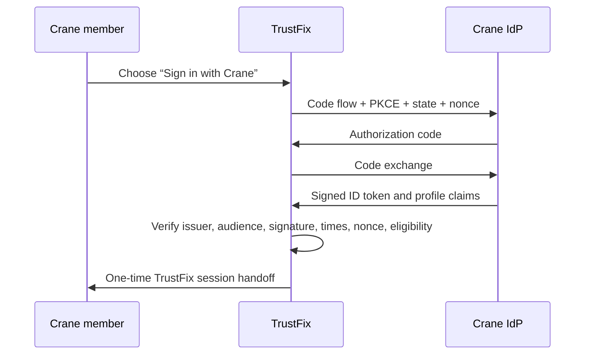

# Crane OIDC, Partner API, and Contractor Invitation Update

This update stages three related integration capabilities for TrustFix:

1. **Crane OpenID Connect sign-in** — TrustFix is an OIDC relying party. A Crane member can authenticate at Crane and enter TrustFix without creating a separate password.
2. **Scoped Crane partner API** — Crane's backend can submit and follow its own authorized service requests without receiving a customer or administrator JWT.
3. **One-time contractor invitations** — an administrator can create a secure, time-limited contractor enrollment link from the TrustFix UI.

All new externally reachable functionality is **disabled by default**. Deploying this update does not enable Crane sign-in, partner API access, or outbound webhooks until the documented environment settings are deliberately changed.

## What Crane still needs to provide

Crane stated that its managed OIDC support is still being evaluated. Before enabling SSO in any environment, request these sandbox details:

- OIDC issuer URL and the provider's `/.well-known/openid-configuration` document.
- A confidential Authorization Code + PKCE client registration.
- The exact HTTPS callback URI registered for the environment.
- Sandbox client ID and a securely exchanged client secret.
- Test accounts for: a new eligible member, an existing TrustFix customer, an inactive member, and a member without verified email.
- The exact eligibility claim/value (for example `membership.active=true`) and a stable membership ID claim.
- Supported ID-token signing algorithm. This build accepts `RS256` by default; `RS384` or `RS512` must be explicitly configured and tested.

Do not enable the feature based solely on an email domain or a mutable display name. TrustFix binds an external identity by the OIDC issuer and stable subject (`iss` + `sub`).

## Test-site configuration

Configure the Laravel API environment first. The callback value must exactly match the URI registered at Crane; do not infer it from the browser-facing frontend URL.

```dotenv
# Feature gates
OIDC_ENABLED=true
OIDC_CRANE_ENABLED=true
PARTNER_API_ENABLED=true

# Replace these with Crane sandbox values.
OIDC_CRANE_ISSUER=https://idp-sandbox.crane.example
OIDC_CRANE_CLIENT_ID=replace-with-crane-sandbox-client-id
OIDC_CRANE_CLIENT_SECRET=replace-with-secret-from-approved-channel

# Example only. Use the externally reachable Laravel/API host for this environment.
OIDC_CRANE_REDIRECT_URI=https://api.lakehousesoftware.com/auth/oidc/crane/callback

OIDC_CRANE_SCOPES="openid,profile,email"
OIDC_CRANE_REQUIRED_CLAIM=membership.active
OIDC_CRANE_REQUIRED_CLAIM_VALUE=true
OIDC_CRANE_MEMBER_ID_CLAIM=member_id
OIDC_CRANE_PARTNER_SLUG=crane
OIDC_CRANE_REQUIRE_VERIFIED_EMAIL=true
OIDC_CRANE_ALLOWED_SIGNING_ALGORITHMS=RS256
OIDC_CRANE_TOKEN_ENDPOINT_AUTH_METHOD=client_secret_basic
```

On the PHP frontend/test-site environment, enable the button only after the backend configuration is live:

```dotenv
TRUSTFIX_OIDC_CRANE_ENABLED=true
# Optional only if the API root cannot be derived from TRUSTFIX_API_BASE.
TRUSTFIX_OIDC_BACKEND_BASE=https://api.lakehousesoftware.com
```

For production, use the real externally reachable Laravel host in `OIDC_CRANE_REDIRECT_URI`; it may be `https://trustfixhome.com/auth/oidc/crane/callback` if that is the host serving Laravel's web routes. Register test and production callbacks separately at Crane.

## OIDC behavior and account linking



- A new verified member receives a `customer` account and an OIDC identity link. No usable local password is created.
- An email collision does **not** automatically link an existing account. The person must authenticate to the existing TrustFix account, then the short-lived link token binds the identity only when its verified provider email matches.
- A valid `member_id` claim maps the member to the partner client whose slug is `crane`. If no matching partner client exists yet, SSO remains safe and works; an administrator can add the member mapping later.
- Authorization Code flow, S256 PKCE, random state, and random nonce are required. The application validates discovery metadata, HTTPS endpoints, the signed RSA ID token, `iss`, `aud`, `azp` when needed, expiry, issue time, not-before, and nonce.
- Browser-visible handoff values are opaque, one-time, short-lived tokens. TrustFix JWTs, ID tokens, access tokens, and OIDC client secrets are never placed in redirect URLs or saved in the database.

## Partner API

An administrator creates each partner client in **Administration → Partner Integrations**. TrustFix shows the API token and webhook signing secret once. Store them in Crane's secret manager, never source code or email.

### Credentials and scopes

Partner requests use a bearer credential in this format:

```http
Authorization: Bearer tfp_<client-uuid>_<random-secret>
Content-Type: application/json
Accept: application/json
```

Available scopes:

| Scope | Permission |
| --- | --- |
| `service_requests:write` | Create a service request for a mapped, active member. |
| `service_requests:read` | Read status and safe activity metadata for that partner's own request. |
| `service_requests:schedule` | Record a scheduling confirmation for that partner's request. |
| `members:read` | Reserved for future member-directory work; it grants no account impersonation. |

Each client is independently active/inactive and its token can be rotated. The stored API token is a password hash; the raw value is not retrievable after creation.

### Endpoints

All paths below are rooted at the Laravel API base, for example `https://api.lakehousesoftware.com/api` on the test deployment.

| Method | Path | Required scope | Behavior |
| --- | --- | --- | --- |
| `POST` | `/partner/v1/service-requests` | `service_requests:write` | Creates a job for a previously mapped active member. Idempotent on `external_request_id` per partner. |
| `GET` | `/partner/v1/service-requests/{externalRequestId}` | `service_requests:read` | Gets the partner's TrustFix job ID, state, and scheduling data. |
| `GET` | `/partner/v1/service-requests/{externalRequestId}/activities` | `service_requests:read` | Gets safe activity types/timestamps without customer or contractor profile data. |
| `POST` | `/partner/v1/service-requests/{externalRequestId}/schedule` | `service_requests:schedule` | Records a scheduling confirmation and reference. |

Example submission:

```bash
curl --request POST 'https://api.lakehousesoftware.com/api/partner/v1/service-requests' \
  --header 'Authorization: Bearer tfp_REPLACE_ME' \
  --header 'Content-Type: application/json' \
  --data '{
    "external_request_id": "CRANE-SR-0001",
    "member_id": "CRANE-1001",
    "description": "Leaking kitchen faucet.",
    "address": "123 Example Street, Denver, CO 80202",
    "skills": ["plumbing"],
    "budget": 250
  }'
```

`member_id` must already map to a TrustFix account for the same partner client. This prevents a partner credential from creating work for arbitrary TrustFix users. A mapping can be created in the administrative UI or automatically after a configured, eligible OIDC login.

### Scheduling and status webhooks

Partner polling is available immediately. Optional outbound webhooks are independently disabled until this is set:

```dotenv
PARTNER_WEBHOOKS_ENABLED=true
# Optional exact host allow-list; recommended once Crane provides its sandbox URL.
PARTNER_WEBHOOK_ALLOWED_HOSTS=sandbox-api.crane.example
```

The configured URL must be HTTPS and public. The sender refuses literal private/reserved IP addresses, disables redirects, applies a timeout, and can enforce the exact host allow-list. TrustFix posts a JSON event with these headers:

```http
X-TrustFix-Event: service_request.status_changed
X-TrustFix-Timestamp: <unix-seconds>
X-TrustFix-Signature: sha256=<hex HMAC-SHA256 of "timestamp.body">
```

Webhook deliveries are queued and retry up to three times for non-2xx responses. Verify the HMAC using the one-time webhook secret before accepting an event.

## Contractor invitations

1. An administrator opens **Administration → Partner Integrations**.
2. They create an invitation with contractor email and optional business defaults.
3. TrustFix emails a one-time link and shows it once for approved alternate delivery if test SMTP is not configured.
4. Opening the link alone does not activate the account. The contractor explicitly chooses **Accept invitation and start profile**.
5. TrustFix creates or upgrades the account to `handyman`, creates a non-public `pending` contractor profile, verifies the email based on possession of the invitation link, and signs the contractor in.

Existing contractors remain subject to the existing approval gate before discovering or accepting jobs. A used, expired, or revoked invitation returns no account token.

## Test plan

Run these after deployment and before GitHub/production promotion:

1. Run `php artisan migrate --force`, then `php artisan optimize:clear`.
2. Visit **Partner Integrations** as an administrator and create a disposable contractor invitation. Confirm the link creates a pending profile exactly once.
3. Create a test partner client and map a known test user. Submit the same external request twice; confirm the second response is an idempotent replay and no second job exists.
4. Record a schedule, then transition the associated TrustFix job. Confirm polling reflects status/time and, if enabled, a sandbox receiver validates its HMAC webhook.
5. With Crane sandbox settings in place, test a new eligible member, existing-account linking, ineligible member, missing/false verified-email claim, invalid state, and expired callback.
6. Confirm both test and production callback URLs are separate registrations at Crane before enabling production flags.

The automated suite includes OIDC signature/state/linking tests, partner-scope and idempotency tests, contractor one-time-invite tests, and webhook-signature tests. Run it from `backend/` with `composer test`.
